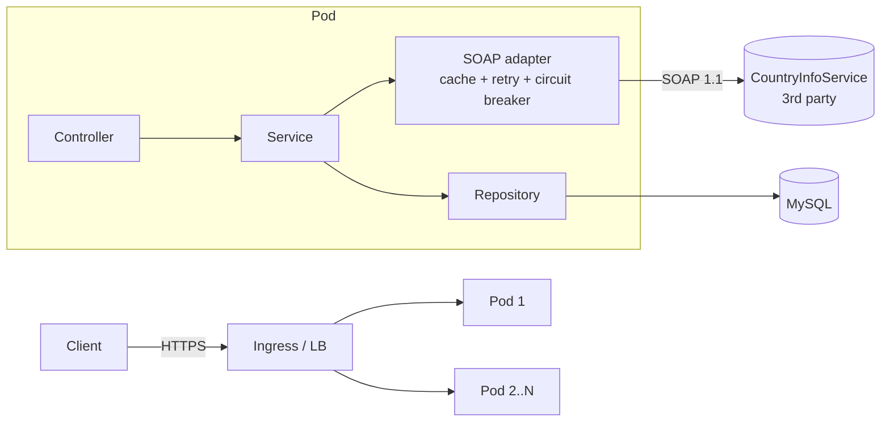

# Architecture and Design Decisions

## 1. Component view

## 2. Request flow (POST /api/v1/countries)
1. Filter assigns/propagates `X-Correlation-Id` (MDC) and logs one access line per request.
2. Controller validates the body (`@Valid`: not blank, length, safe characters).
3. Service sentence-cases the name (`kenya` -> `Kenya`).
4. SOAP adapter: `CountryISOCode(sCountryName)` -> `KE` -> `FullCountryInfo(sCountryISOCode)`.
5. Service upserts `CountryInfo` + `Language` rows in one DB transaction keyed by ISO code (idempotent: repeating the call refreshes, never duplicates).
6. Returns 201 (new) or 200 (existing).

## 3. Key decisions and trade-offs

| Decision | Why | Trade-off |
|---|---|---|
| **Layered MVC** (controller / service / repository / entity, DTOs at the edge) | Clear separation of concerns; entities never leak into the API | A few extra mapping classes |
| **Raw SOAP 1.1 over `RestClient` + DOM parsing** instead of WSDL code generation (JAX-WS/Spring-WS) | Only two simple operations; no generated code, no build-time dependency on a flaky third-party WSDL, easy to unit test | If the integration grows to many operations, generate a client from the WSDL |
| **Stateless pods** | Any pod can serve any request, so scaling is just replicas + HPA | State lives only in MySQL (and a per-pod cache) |
| **Caching** (Caffeine, 24h) on name->ISO and ISO->full info | Country data is near-static; removes most upstream calls under load and shields us from upstream latency | Per-pod cache (some duplicate upstream calls across pods; stale up to 24h). Redis would share it |
| **Timeouts** (3s connect, 5s read) | A slow upstream must never hold request threads | Aggressive; tunable via env |
| **Retry** (3 attempts, exp. backoff 0.5s/1s) on upstream errors only | Absorbs transient faults | Adds latency on failure; not applied to "country not found" (a business answer, not a fault) |
| **Circuit breaker** (50% failures over 10 calls, 20s open) | Fail fast and give the upstream room to recover instead of piling on | Brief window where valid calls are rejected |
| **Fallback to stored data**, else HTTP 503 | Graceful degradation: previously stored countries still work when the SOAP service is down | Data may be older than upstream; flagged via `X-Data-Source` header |
| **SOAP calls outside DB transactions** | A slow upstream never pins a DB connection (protects the Hikari pool) | Slightly more code (TransactionTemplate) |
| **Upsert by unique ISO code** | Idempotent POST, safe to retry, no duplicates under concurrency (unique index) | Concurrent first-time inserts of the same country: one gets a constraint error (rare; client retry succeeds) |
| **Hibernate `ddl-auto=update`** | Zero-setup for the exercise | Not for production; use Flyway + `validate` |
| **Synchronous request/response** | Lookups are fast and the user wants the result | Under extreme load or a long upstream outage, a queue would help (see below) |

## 4. Designing for high load
- **Horizontal scaling**: stateless pods behind a Service/Ingress, HPA at 70% CPU (2-10 replicas), PodDisruptionBudget, topology spread across nodes, zero-downtime rolling updates.
- **Read path** (GET endpoints) hits only MySQL (indexed by PK), paginated with a hard size cap of 100.
- **Write path** is dominated by upstream latency; caching and the circuit breaker bound it.
- **Connection management**: Hikari pool capped per pod (10) so N pods x pool size stays under MySQL `max_connections`.
- **Edge protection**: ingress rate limit; optional per-client limiting at an API gateway.
- **Future evolution**: for bursty bulk lookups, accept the request (202), publish to Kafka/RabbitMQ, and have consumers call SOAP at a controlled rate (queue-based load levelling); add Redis for a shared cache; add MySQL read replicas for read-heavy traffic.

## 5. Failure handling matrix

| Failure | Behaviour |
|---|---|
| SOAP slow/unreachable | Timeout -> retry x3 with backoff -> circuit opens -> stored fallback (200 + `X-Data-Source`) or 503 |
| SOAP returns "country not found" | 404, no retry, circuit unaffected |
| SOAP returns garbage/invalid XML | Treated as upstream failure (retry/breaker); XXE disabled in the parser |
| MySQL down | Readiness probe fails -> pod removed from the Service; 500 for in-flight calls; liveness stays up so pods are not needlessly restarted |
| Pod killed / rolling update | preStop sleep + graceful shutdown drains in-flight requests |
| Bad input | 400 with field-level details |

## 6. Observability
- **Logs**: structured JSON (prod) with `correlationId`, one access line per request, lines for each SOAP call, fallback and CRUD event. No secrets or full payloads logged.
- **Metrics**: Micrometer -> Prometheus: HTTP latency/throughput (`http_server_requests_*`), JVM, Hikari, circuit breaker state and retry counts, `country_lookup_total{outcome}`.
- **Suggested alerts**: circuit breaker open > 2 min; 5xx rate > 1%; p95 latency > 2s; readiness failures; `country_lookup_total{outcome="fallback"}` rising.
- **Tracing**: correlation ID today; add OpenTelemetry (Micrometer Tracing) to get cross-service spans.

## 7. Security notes
Non-root container with read-only filesystem and dropped capabilities; secrets via Kubernetes Secret (created by script, never committed); NetworkPolicy restricts MySQL to the app; input validated and XML-escaped when building SOAP requests; error responses never include stack traces. Next steps: TLS at ingress, authentication (OAuth2/JWT) on the API, and a secret manager (Vault / cloud KMS).
